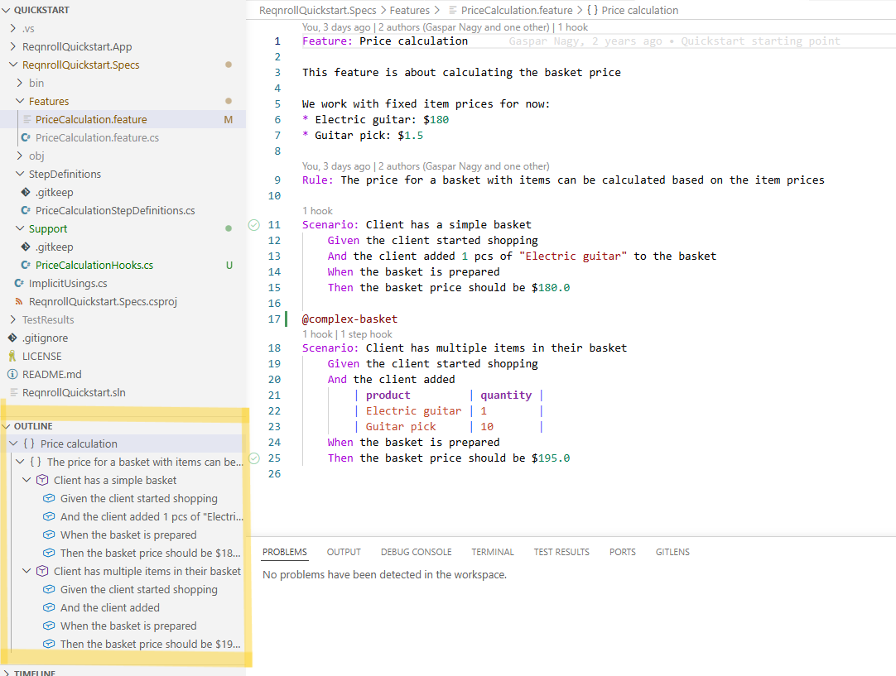
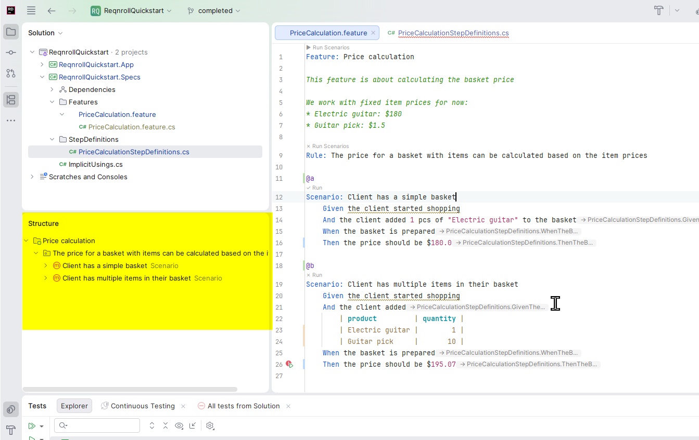

# Document Outline

Your IDE's Outline / Structure panel shows the hierarchy of the open
feature file — Feature → Background / Rule → Scenario / Scenario Outline →
Step — and clicking a node jumps to that location. Useful for navigating a
large feature file without scrolling.

* **VS Code**: shown in the native Outline panel.
* **Rider**: shown in Rider's native Structure view, which renders the
  language server's `textDocument/documentSymbol` response. Older Rider
  versions that don't support this don't show a Gherkin outline.

:::{tab-set}

```{tab-item} VS Code
:sync: vscode


```

```{tab-item} Rider
:sync: rider


```

:::

```{admonition} Visual Studio does not show a Gherkin outline
:class: warning

Visual Studio's native Document Outline window does not support `.feature`
files — this is a known VS limitation (its outline is built on an older
COM-based mechanism this extension's language server support doesn't route
through), not a bug in this extension. Outline navigation is available in
VS Code and Rider, as described above.
```
