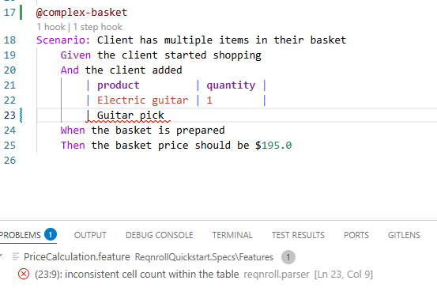
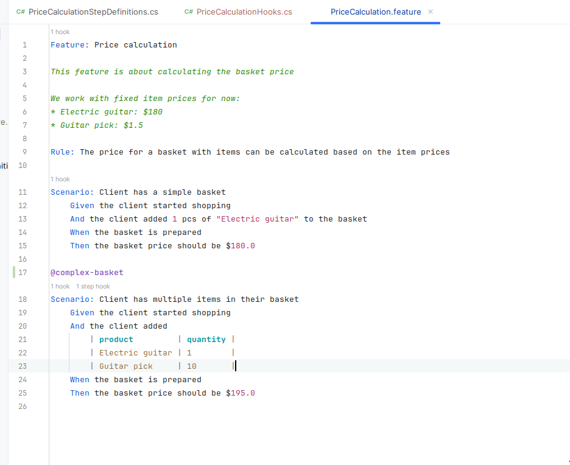

# Document & Table Formatting

## Format Document

Formatting the whole document (Shift+Alt+F, or your IDE's equivalent
shortcut) re-indents the entire `.feature` file, providing consistent indentation per
nesting level, normalized spacing around keywords, and blank lines between
scenarios. Formatting rules are read from `.editorconfig` — see
[Gherkin Formatting with EditorConfig](../editorconfig.md) for the full
settings reference.

## Table formatting

Typing `|` or pressing Enter inside a Gherkin data table or `Examples:`
table pads the columns so the pipes stay aligned as you type. A table can
also be re-aligned by running Format Document. A row missing its trailing
`|` gets one appended automatically.

:::{tab-set}

```{tab-item} Visual Studio
:sync: vs


```

```{tab-item} VS Code
:sync: vscode


```

```{tab-item} Rider
:sync: rider


```

:::


