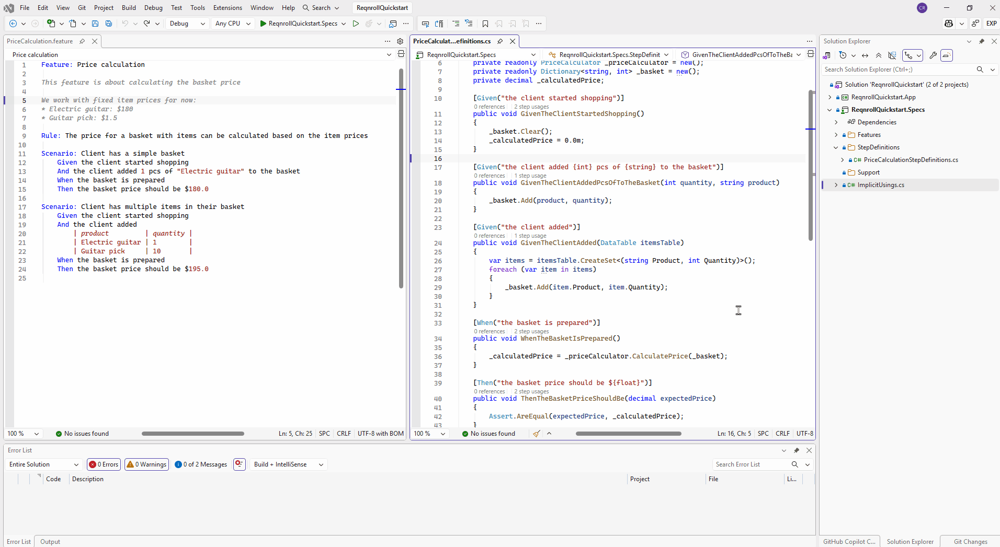
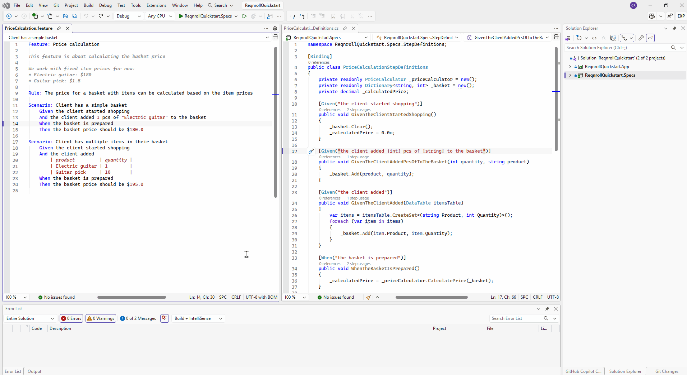
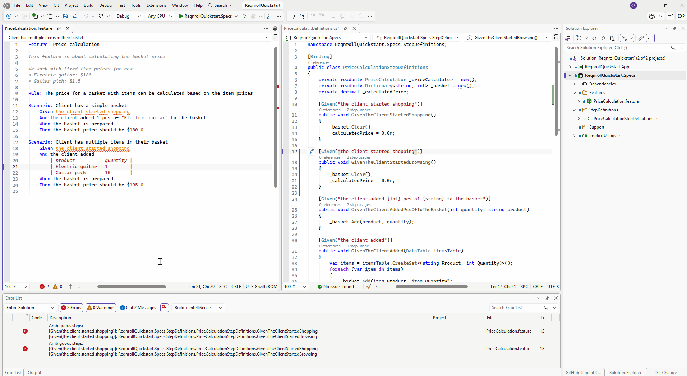
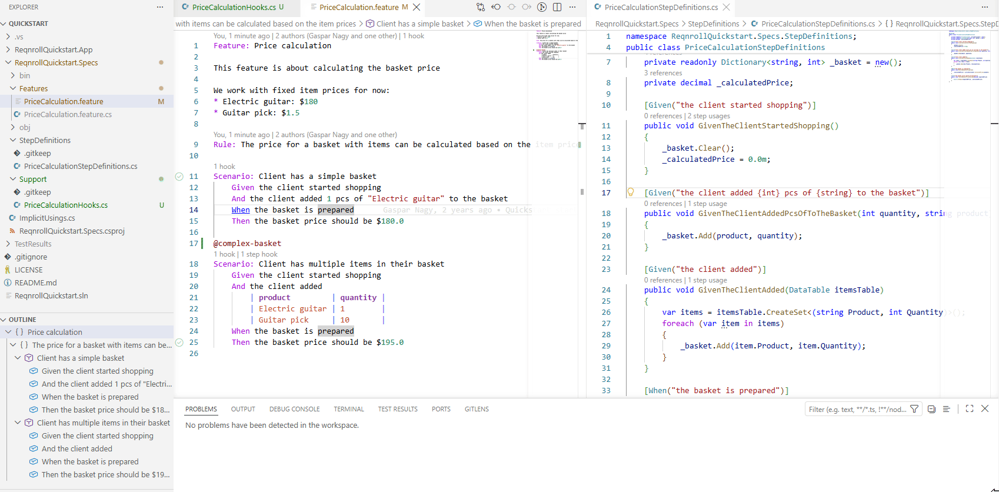
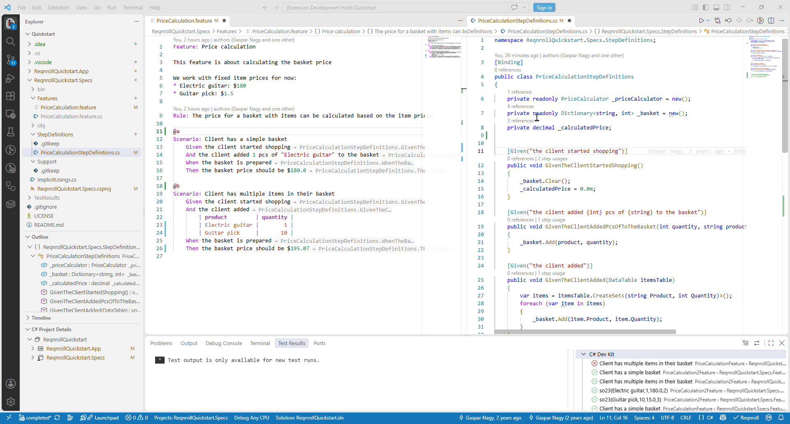
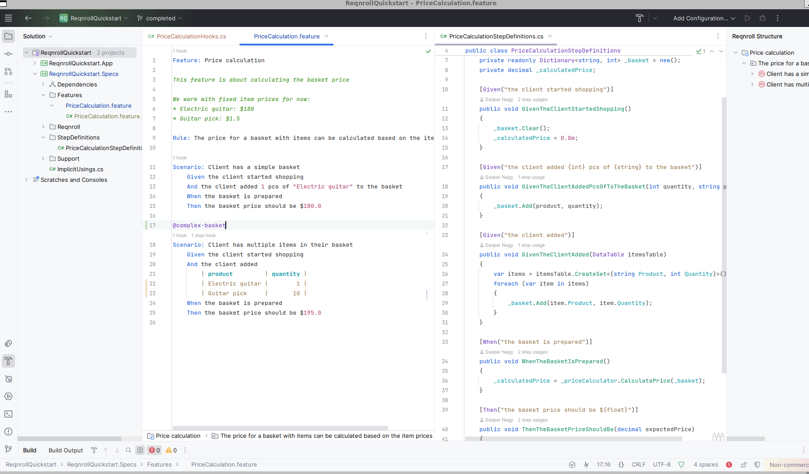
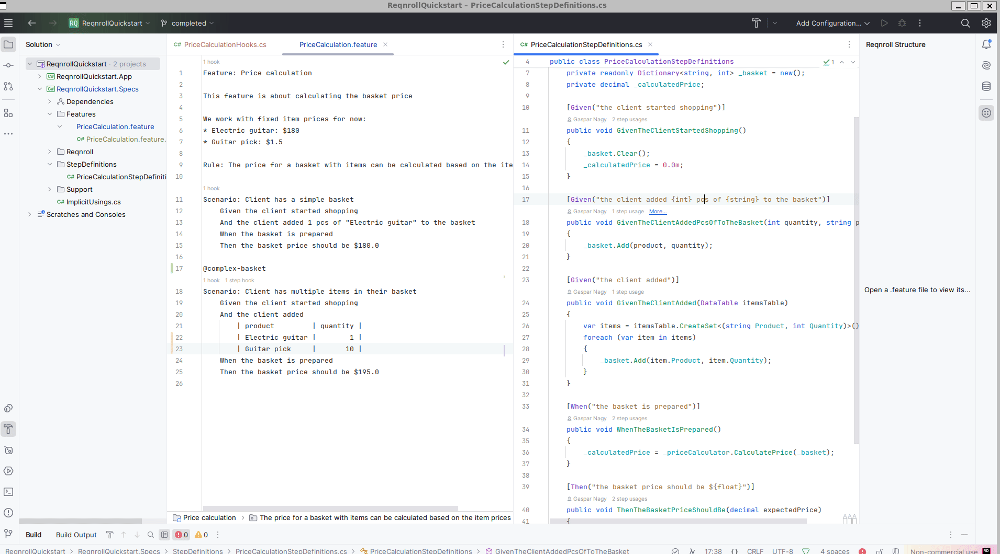
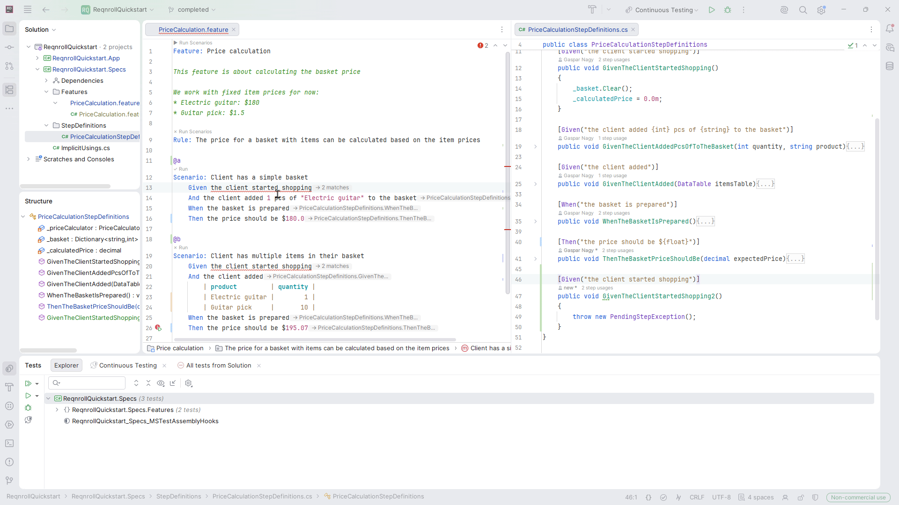

# Rename Step

Renaming a step's text — from either the `.feature` file step line or the
C# `[Given("...")]`/`[When("...")]`/`[Then("...")]` attribute string —
updates every occurrence across the workspace: the attribute string in the
binding class, and every matching step in every `.feature` file.

::::{tab-set}

```{tab-item} Visual Studio
:sync: vs

Place the cursor on the step (in a `.feature` file) or the attribute string
(in a `.cs` file) and invoke the standard **Rename** gesture (F2). This
handles the common, unambiguous case directly.

**Renaming from the feature file**



**Renaming from the binding expression**



**Renaming an ambiguously bound step**

If a binding method has more than one candidate attribute, use
right-click → **Rename Step...** (in the Reqnroll group of the editor context menu) instead — it opens a dialog with a
picker to choose which binding to rename.


```

```{tab-item} VS Code
:sync: vscode

Place the cursor on the step (in a `.feature` file) or on the attribute string (in a `.cs`
file) and press **F2**. You can also use right-click → **Reqnroll: Rename Step...** or the
Command Palette in either file type.

**Renaming from the feature file**



**Renaming from the binding expression**



**Renaming an ambiguously bound step**

If the step matches more than one candidate binding attribute, a Quick Pick asks which one you
mean before the rename prompt appears.

If the language server rejects the rename for a reason you can fix (for example a changed
parameter count), the reason is shown in a modal dialog.
```

```{tab-item} Rider
:sync: rider

- **On the `.feature` step line:** press **Shift+F6**, or right-click →
  **Reqnroll: Rename Step...**.
- **On the C# attribute:** right-click → **Reqnroll: Rename Step...** — it sits
  in the Reqnroll group of the context menu, set off by separators from Rider's
  native "Rename" entry, and the `Reqnroll: ` prefix marks it as ours, since
  native Shift+F6 stays bound to ordinary C# symbol rename here.

Both surfaces handle disambiguation via a picker when the binding has more
than one candidate attribute.

**Renaming from the feature file**



**Renaming from the binding expression**



**Renaming an ambiguously bound step**


```

::::
