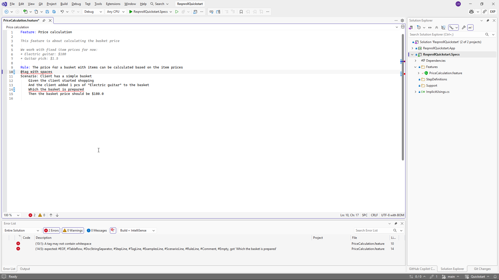
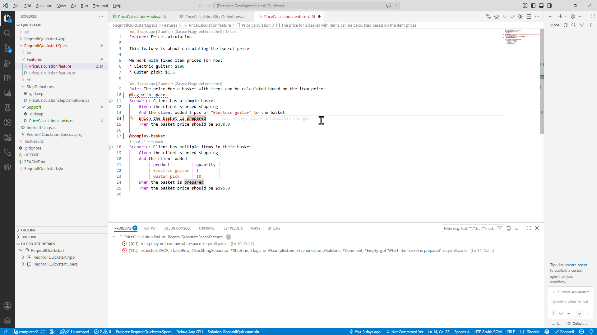
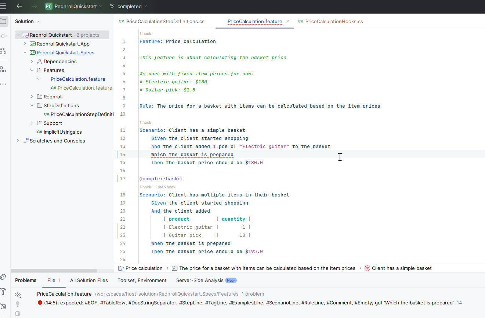

# Syntax Highlighting

Keywords (`Feature:`, `Scenario:`, `Given`, `When`, `Then`, `And`, `But`),
step text, bound step argument text, tags (`@tag`), doc strings, data table
headers, data table cell content, and comments each render in distinct
colors, matching your IDE's color theme. Colors update as you type — no
save required. Steps with no matching binding render in a distinct
"undefined step" color.

:::{tab-set}

```{tab-item} Visual Studio
:sync: vs


```

```{tab-item} VS Code
:sync: vscode


```

```{tab-item} Rider
:sync: rider


```

:::

## Non-English (dialect) keywords

Highlighting works the same for non-English Gherkin dialects (e.g. German,
French, Dutch) — the active dialect is read from the project's
`reqnroll.json` (default: `en`). See
[Feature Language](https://docs.reqnroll.net/latest/gherkin/feature-language.html)
in the main Reqnroll docs for the full list of supported languages and how
to set one.
