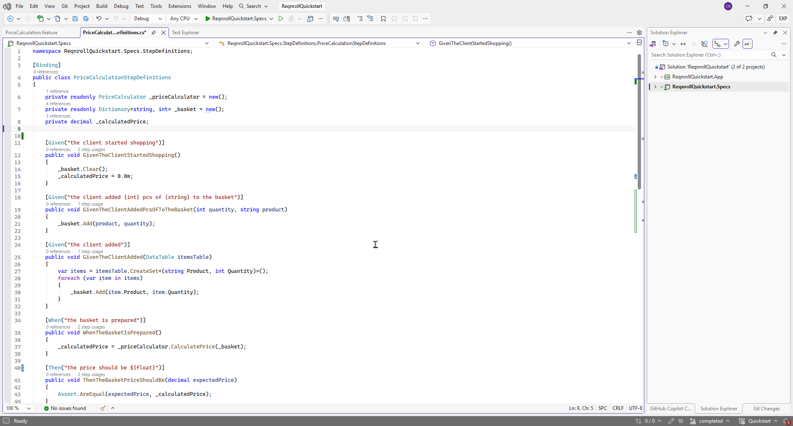
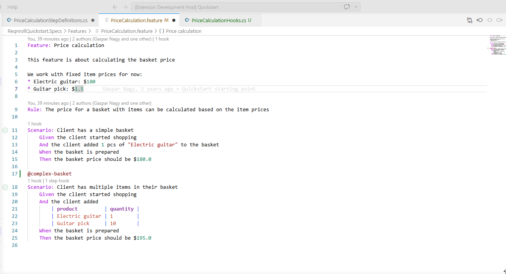
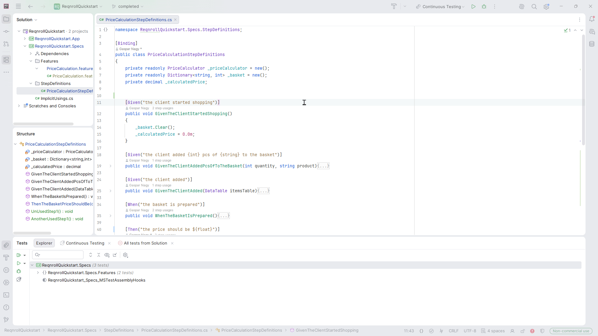

# Find Unused Step Definitions

The **Find Unused Step Definitions** command scans your project's step
bindings against every `.feature` file in the workspace and reports any
binding method with zero matching steps — useful for spotting dead code
after a scenario is rewritten or removed. It's a workspace-wide operation
— unlike [Find Step Definition Usages](find-usages.md), it doesn't need
your cursor on anything first.

:::{tab-set}

```{tab-item} Visual Studio
:sync: vs

Right-click in a C# editor → **Find Unused Step Definitions in Projects**
(in the Reqnroll group of the editor context menu). There's no keybinding for
this one — it's a workspace-wide scan, not tied to a specific line.


```

```{tab-item} VS Code
:sync: vscode

Right-click in a C# file → **Reqnroll: Find Unused Step Definitions in Projects**, or Command Palette → **Reqnroll: Find Unused Step Definitions in Projects**. There's no default keybinding.


```

```{tab-item} Rider
:sync: rider

Right-click in a C# editor → **Reqnroll: Find Unused Step Definitions in Projects**,
or use **Reqnroll: Find Unused Step Definitions in Projects** from Find Action
(Ctrl+Shift+A). No default keybinding.


```

:::
