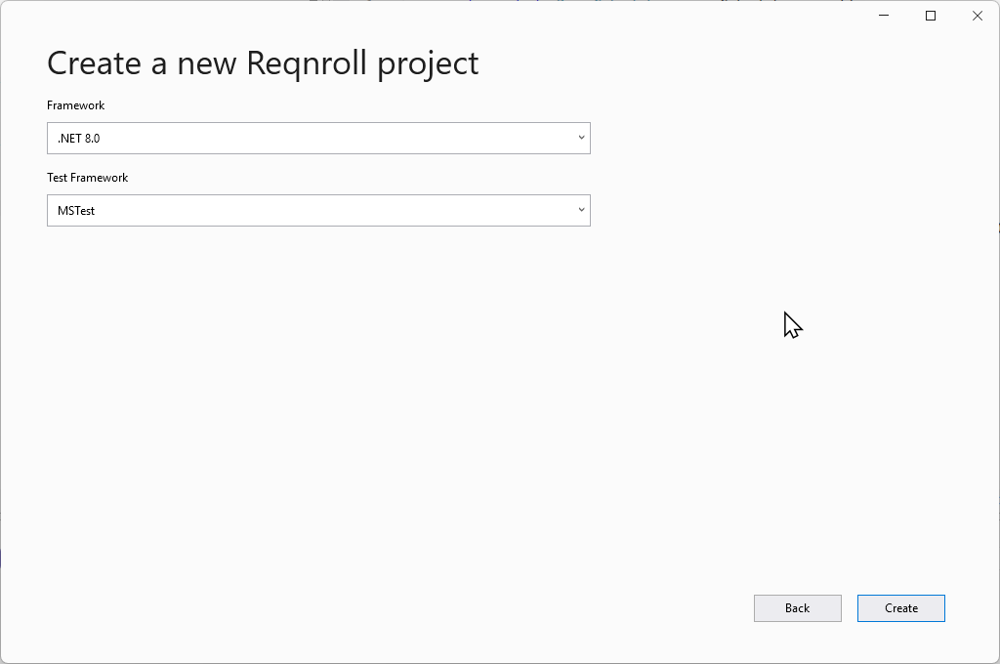
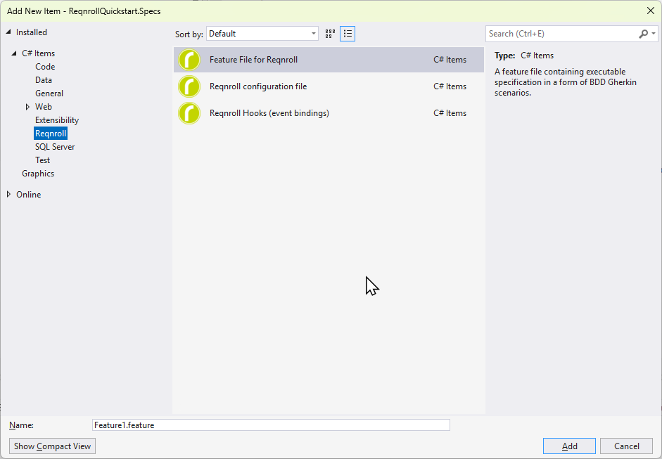

# New Project / Item Templates

In Visual Studio, **New Project** offers a Reqnroll project template with a
test framework picker (NUnit, xUnit, MSTest). 

**Add New Item** offers a
blank `.feature` file template and a step definitions class template.






```{admonition} Visual Studio only
:class: note

VS Code and Rider don't have an equivalent project wizard, and the extensions do not ship
snippets or live templates for new files. Create the `.feature` file or class with your IDE's
normal New File command; for step definitions, start from the steps in the `.feature` file and use
the *Define missing step* quick fix. See
[Defining Steps](editing-features/defining-steps.md) for scaffolding a single missing step
binding, which works the same way across all three IDEs.
```
