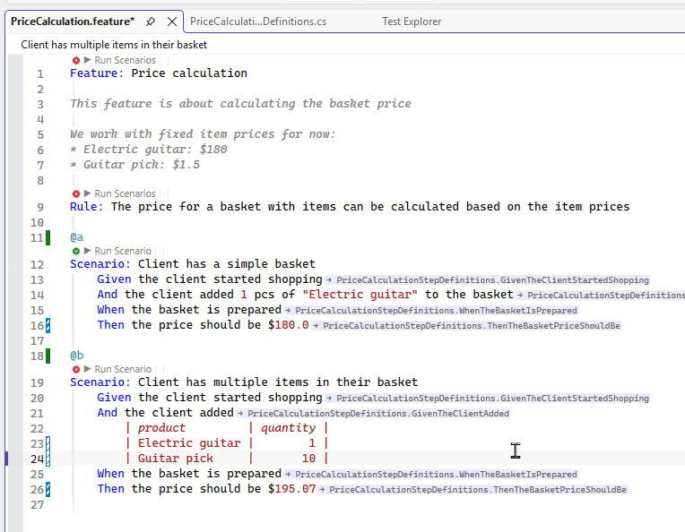
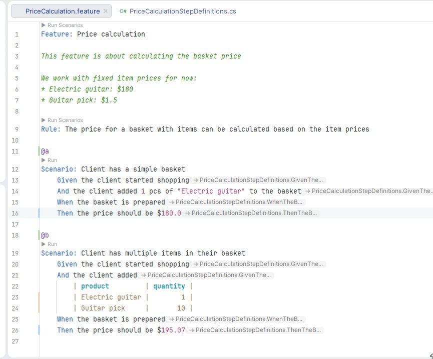

# Running Scenarios

A **Run** lens appears above each `Scenario:`/`Scenario Outline:` line, letting you run (and, where
supported, debug) the generated test for that scenario directly from the `.feature` file — no need
to find the corresponding method in `<Feature>.feature.cs` first.

Pass/fail results shown by this feature (in Visual Studio, Rider, and VS Code's opt-in CodeLens
below) are sourced from a VSTest logger bundled with the extension, which streams results to the
extension as the test run happens rather than waiting for the run to finish and re-parsing a
results file. This gives every **Scenario Outline** its own per-`Examples:`-row result — and, on a
failure, which specific step failed — instead of one aggregate pass/fail for the whole scenario.
Results only update from a run the IDE itself observed (see each tab below for what counts); a
`dotnet test` run from a separate terminal is never observed and won't update anything shown here.

```{admonition} Requires a build
:class: note

The lens resolves against the generated `<Feature>.feature.cs` test method, which only exists once
the project has built at least once. Nothing appears above a scenario in a project that has never
built successfully — build the project, and the lens appears without needing to reopen the file.
```

```{admonition} Scenario Outline runs every example row together
:class: note

By default (`allowRowTests`, Reqnroll's own setting), all of a Scenario Outline's `Examples:` rows
compile into **one** parameterized test method. Running from the `Scenario Outline:` line runs that
whole method — every row — in one go; there's currently no way to run a single `Examples:` row on
its own from this lens.
```

::::{tab-set}

````{tab-item} Visual Studio
:sync: vs

Above each scenario, a `▶ Run Scenario` (or `▶ Run Scenarios` for an Outline) lens delegates
straight to Visual Studio's own Test Explorer — clicking it opens a Details popup with three
actions:

- **Run** / **Debug** — runs the generated test the same way Test Explorer's own CodeLens would for
  an ordinary `[Fact]`/`[Test]`/`[TestMethod]`, including breakpoints during Debug.
- **Show in Test Explorer** — jumps straight to the test's entry in the Test Explorer tool window,
  where its full pass/fail history and output live.

Once the test has been run at least once from Test Explorer (via this lens, Test Explorer's own UI,
or the Debug action above), the lens picks up a pass/fail glyph. For a Scenario Outline, each
`Examples:` row is tracked and reported individually — clicking through to the Details popup shows
which row failed and, for a failure, the specific step it failed on. Outcomes persist across
Visual Studio restarts; they're automatically discarded the next time the project is rebuilt, so a
stale green/red glyph from before a code change never lingers — the glyph simply disappears until
the scenario is run again.

**Feature and Rule block header lines** get their own `▶ Run Scenarios` lens, running every
Scenario/Scenario Outline the block contains (including a Feature's Rule-nested scenarios) as a
single batched Test Explorer run — the same Details popup and pass/fail tracking as a single
scenario's lens, just over the whole container. `Background:` steps are never run on their own.



```{admonition} MSTest runs using Microsoft.Testing.Platform
:class: note

Per-row Outline detail requires the run to go through VSTest (the default for MSTest, NUnit, and
xUnit test projects). Projects opted into the newer Microsoft.Testing.Platform runner instead fall
back to Visual Studio's own built-in test outcome tracking — a single aggregate glyph per scenario,
same as before this per-row support existed.
```
````

````{tab-item} VS Code
:sync: vscode

VS Code has no Reqnroll-owned Run feature for `.feature` files — this is intentionally deferred to
the official **C# Dev Kit** extension, which already discovers Reqnroll's generated test methods
and shows them in its native Test Explorer and editor CodeLens over `<Feature>.feature.cs`.

```{admonition} Install C# Dev Kit to run scenarios
:class: important

Without C# Dev Kit installed, there is currently no way to run or debug a scenario from within VS
Code. Install the [C# Dev Kit](https://marketplace.visualstudio.com/items?itemName=ms-dotnettools.csdevkit)
extension, then use its Test Explorer or its CodeLens on the generated test method in
`<Feature>.feature.cs` to run and debug scenarios.
```

An earlier version of this extension had its own `.feature`-side Run CodeLens with independent
pass/fail tracking. It was removed after live use showed it added nothing C# Dev Kit's own
discovery and Test Explorer integration didn't already cover, and having two separate run
mechanisms was more confusing than helpful.

### Optional: read-only pass/fail CodeLens

Independently of the above, this extension can show a **read-only** `✓`/`✗` CodeLens above each
Scenario/Scenario Outline line, sourced the same way VS's and Rider's outcome glyphs are. It's
off by default — enable it with:

```json
"reqnroll.testOutcomes.enabled": true
```

(Settings UI: **Reqnroll › Test Outcomes: Enabled**.) Reload the window after changing it.

This lens has no click action — it never runs, cancels, or otherwise touches a test, only reports
the last outcome the extension observed. Enabling it merges the bundled VSTest logger into
whatever `dotnet.unitTests.runSettingsPath` C# Dev Kit already uses for its own runs, so
outcomes appear from C# Dev Kit's normal Run/Debug flow with no separate run mechanism to trigger.
What it adds that C# Dev Kit's own `.cs`-side CodeLens/Test Explorer can't: it sits directly on the
`.feature` file, and for a Scenario Outline it names which `Examples:` row failed and on which
step, instead of one aggregate result for the whole generated method.

```{admonition} This changes a setting C# Dev Kit also reads
:class: note

`dotnet.unitTests.runSettingsPath` is an ordinary shared VS Code setting, not one this extension
owns — if your workspace already points it at a `.runsettings` file, that file's content is
preserved and merged with the bundled logger's configuration, never replaced. If you turn the
CodeLens off again, re-run a build so C# Dev Kit picks up the setting change cleanly.
```

```{admonition} No outcome shown for Microsoft.Testing.Platform projects
:class: warning

This CodeLens is sourced from the same bundled VSTest logger as VS's and Rider's outcome glyphs —
a project running under
[Microsoft.Testing.Platform](https://learn.microsoft.com/dotnet/core/testing/microsoft-testing-platform-intro)
instead of VSTest (for example, `TestingPlatformDotnetTestSupport=true`) never feeds it any data.
Unlike Visual Studio and Rider, there's no fallback source here — the CodeLens simply never
appears on that project's scenarios, rather than showing a stale or incorrect result. Use C# Dev
Kit's own Test Explorer for results on those projects.
```
````

````{tab-item} Rider
:sync: rider

Above each scenario, an inline `▶ Run` lens runs the generated test directly (`dotnet test
--filter`, scoped to that scenario's method). Once it's been run, the lens updates to `✓ Run` or
`✗ Run` depending on the last outcome — and, for a Scenario Outline, each `Examples:` row is
tracked individually, with the specific failed step named for a failing row.

**Feature and Rule block header lines** get their own `▶ Run Scenarios` lens, running every
Scenario/Scenario Outline the block contains (including a Feature's Rule-nested scenarios) as a
single batched `dotnet test` run — the same outcome glyph and per-row tracking as a single
scenario's lens, just over the whole container. `Background:` steps are never run on their own.



After a run, the step that failed gets a red failed-test icon in the editor gutter. Hovering it
shows the traced step and the error text. The icon is located from Reqnroll's step trace, not the
stack trace, so it points at the right step rather than the scenario's last one.

```{admonition} Run only — no Debug, no Test Runner tool window presence
:class: warning

This lens only runs the test; there's no debug variant, and the run doesn't show up in Rider's
native Unit Tests tool window — Rider's .NET test integration has no extension point this plugin
can currently plug into for that. Treat it as a quick way to check one scenario without leaving the
`.feature` file; for debugging, or for running/reviewing a whole suite, use Rider's own Test Runner
against the generated test project directly.
```

```{admonition} Microsoft.Testing.Platform projects
:class: note

Projects running under [Microsoft.Testing.Platform](https://learn.microsoft.com/dotnet/core/testing/microsoft-testing-platform-intro)
instead of VSTest produce no TRX file. The lens takes the pass/fail result from the test process's
exit code, so you get an aggregate glyph for the scenario. The per-`Examples:`-row breakdown and
failed-step detail also need the language server's outcome pipeline to be reachable; if it is not,
the aggregate result is still shown.
```
````

::::

## Troubleshooting

**The Run lens never appears above a scenario.** Confirm the project has built successfully at
least once — the lens needs the generated `<Feature>.feature.cs` test method to resolve against,
which doesn't exist before a first build. If it's still missing after a successful build, check
that the scenario's title actually produces a distinct generated method name (an empty or
whitespace-only `Scenario:` title, for instance, has nothing to resolve to).

**Rider: running a scenario fails with a `dotnet` CLI error.** Rider (and Visual Studio's fallback
path) locate the `dotnet` CLI via `PATH`, then `DOTNET_ROOT`, then well-known install locations. If
none of those resolve — most commonly a GUI-launched IDE process with a minimal environment — the
error message says so explicitly; make sure the .NET SDK is installed and reachable from the
environment your IDE was launched in.

**Rider: a run stops with "dotnet test … did not finish within 120 seconds".** The Rider Run lens
gives each `dotnet test` run 120 seconds in total, and that budget includes the build `dotnet test`
performs first, so a large solution that has to rebuild can use it up before any test starts. When
the limit is hit the run is stopped (along with the MSBuild and test-host processes it started)
rather than left running in the background. To raise it, choose **Help | Edit Custom VM Options…**
in Rider, add the line below (the value is in seconds; anything that is not a positive whole number
is ignored and the default of 120 is used), and restart Rider:

```text
-Dreqnroll.rider.dotnetTestTimeoutSeconds=300
```

Pressing the cancel button on a running lens stops the run the same way, immediately.

**A pass/fail glyph disappeared after I rebuilt, even though I haven't re-run the scenario.** This
is expected, not a bug — a result is only trusted for the exact build that produced it. As soon as
the project is rebuilt, the previous outcome is treated as describing code that no longer exists
and is dropped rather than shown as a possibly-wrong green/red. Run the scenario again to get a
current result.

**Visual Studio: the pass/fail glyph never updates, or updates slowly, after a test run.** The
glyph is fed by a Reqnroll-bundled VSTest logger the extension injects into each test run's
runsettings automatically. One environment variable is a kill switch for that pipeline; two more
mirror its outcome stream to disk for troubleshooting or attaching to a bug report — but only one of
those two applies at a time, and which one depends on **how the tests are being run**, not on which
one you'd rather use:

- `REQNROLL_IDE_DISABLE_TEST_LOGGER` — set to any value other than empty, `0`, or `false` to disable
  logger injection entirely. With it disabled, the glyph falls back to Visual Studio's own built-in
  test-outcome cache instead. Use this to rule out (or work around) a misbehaving logger without
  uninstalling the extension.
- **Running through Visual Studio's Test Explorer** (the normal case — this is what feeds the
  glyph): set `REQNROLL_IDE_TEST_LOGGER_MIRROR`, in the environment `devenv.exe` itself was launched
  in, to `1` (writes to an auto-named file under the standard Reqnroll log directory,
  `reqnroll-vs-testlogger-<date>-<pid>.ndjson`) or to an explicit path. The extension injects this
  as a `LogFilePath` runsettings parameter, which is the only delivery mechanism guaranteed to reach
  the test host process regardless of how Visual Studio's test infrastructure ends up spawning it.
- **Running tests without Visual Studio in the picture at all** — a bare `dotnet test`, a CI
  pipeline, or any other direct `vstest` invocation that has the bundled logger wired in manually:
  set `REQNROLL_TESTLOGGER_FILE` (always an explicit path — no `1` shorthand) on that process's own
  environment instead. There's no extension present to inject a runsettings parameter in this case,
  so the logger reads its own environment directly.

These aren't interchangeable — if both happen to be set during a Visual Studio-orchestrated run,
the injected runsettings parameter always wins and `REQNROLL_TESTLOGGER_FILE` is silently ignored,
which is confusing to debug if you don't know that precedence exists. Set whichever one matches how
you're actually running the tests, not both.

`REQNROLL_IDE_DISABLE_TEST_LOGGER` and `REQNROLL_IDE_TEST_LOGGER_MIRROR` are read from devenv's own
process environment on every test run, but a process's environment is fixed at launch — set them as
a user/system environment variable, or in the shell used to start `devenv.exe`, *before* opening
Visual Studio. Setting them while Visual Studio is already running has no effect until it's closed
and reopened from an environment where the variable is set.

**VS Code: the outcome CodeLens never appears for a particular project, even after a successful
run.** Confirm the project isn't running under Microsoft.Testing.Platform instead of VSTest — this
CodeLens has no fallback source for that case (see the admonition on the VS Code tab above), so it
never appears at all rather than showing a stale result.

**VS Code: the outcome CodeLens doesn't appear (or doesn't update) after enabling the setting.**
Reload the window (**Developer: Reload Window**) after toggling `reqnroll.testOutcomes.enabled` —
it isn't picked up live. If it's still missing after a reload, confirm the project has built at
least once (same requirement as the Run lens in the other IDEs) and that C# Dev Kit is installed
and has actually run the test at least once from its own Test Explorer or gutter — this CodeLens
never triggers a run itself, it only reports on ones C# Dev Kit already ran.
