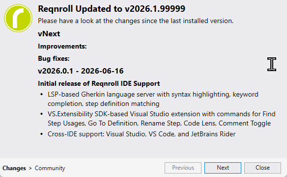

# Upgrading

Each IDE shows a first-run "what's new" experience the first time you open
it after a fresh install or an upgrade to a new version — the extension
distinguishes "first install" from "upgrade" so you're not shown the same
welcome content on every update.

* **Visual Studio** — the existing Reqnroll for Visual Studio extension's
  welcome page (ported WPF UI) and version-detection logic are reused, so an
  upgrade is detected the same way it already is for that extension.
* **VS Code** — a native [Walkthrough](https://code.visualstudio.com/api/ux-guidelines/walkthroughs)
  is shown.
* **Rider** — the plugin's own change-notes panel is shown.

## Release notes

The authoritative, always-up-to-date changelog for all three IDEs is the
[Reqnroll.IdeSupport GitHub Releases page](https://github.com/reqnroll/Reqnroll.IdeSupport/releases)
— every release lists what changed, cross-linked to the issues/PRs that
shipped it. Each IDE also surfaces a version-appropriate subset natively:

* **Visual Studio** — the "What's New" panel above.
* **VS Code** — the Walkthrough, or the Marketplace listing's "Version
  History" / Changelog tab.
* **Rider** — the plugin's own change-notes panel, or the JetBrains
  Marketplace listing's changelog tab.

If a native panel seems out of date or you want the full history, check
GitHub Releases directly.
